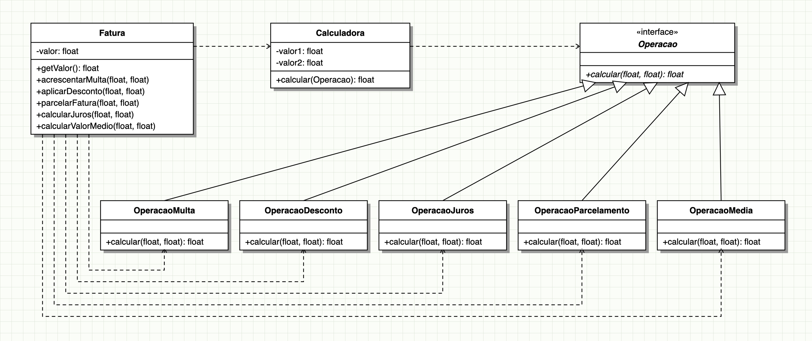

# Strategy — Cálculo de Fatura de Cobrança

Implementação do padrão de projeto **Strategy**, aplicada ao cálculo de faturas de cobrança: a fatura escolhe a operação (multa, desconto, juros, parcelamento ou valor médio) que a calculadora deve executar.

## Diagrama UML



Versão editável em Mermaid: [docs/diagrama-uml.md](docs/diagrama-uml.md).

## Como rodar os testes

```
mvn test
```
